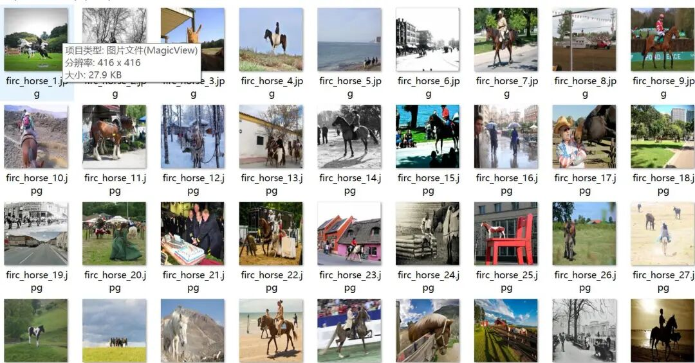
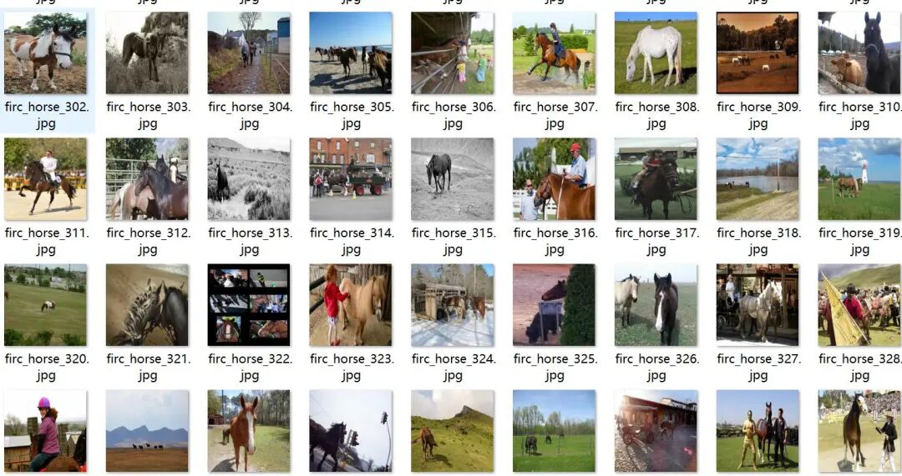
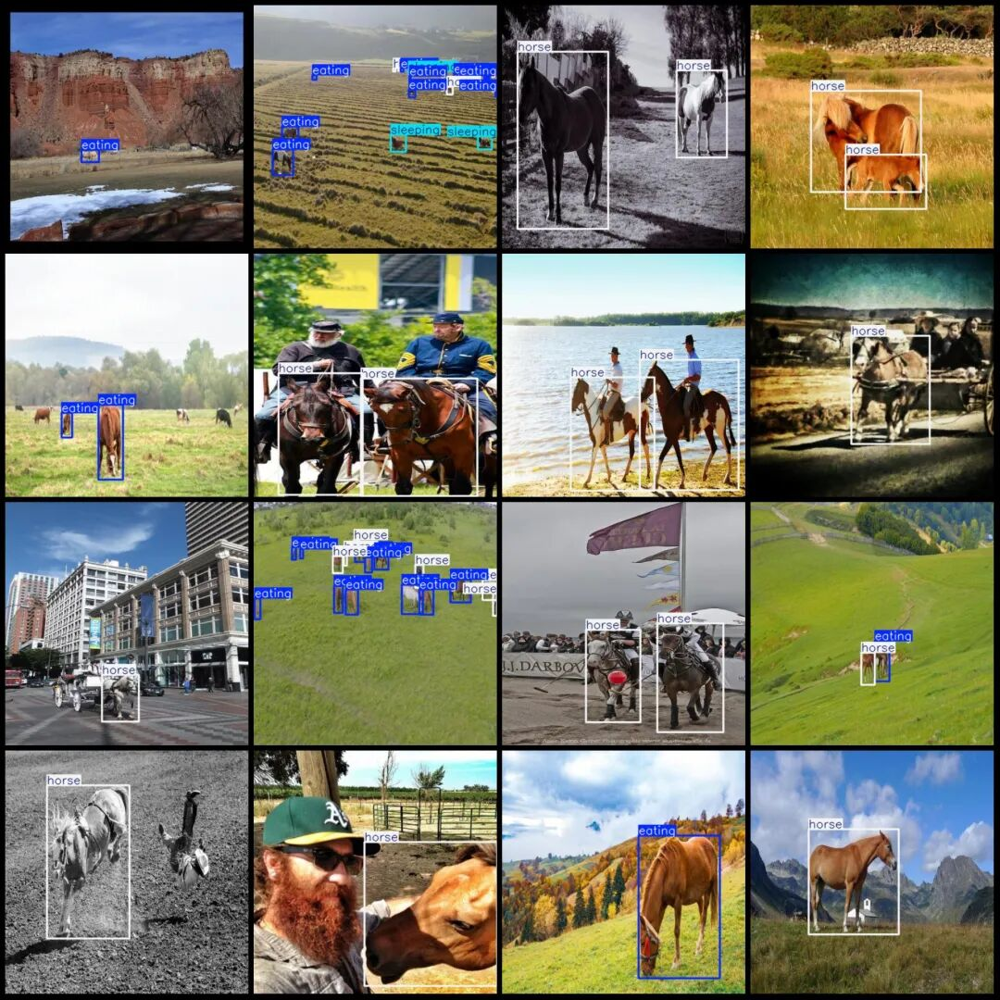
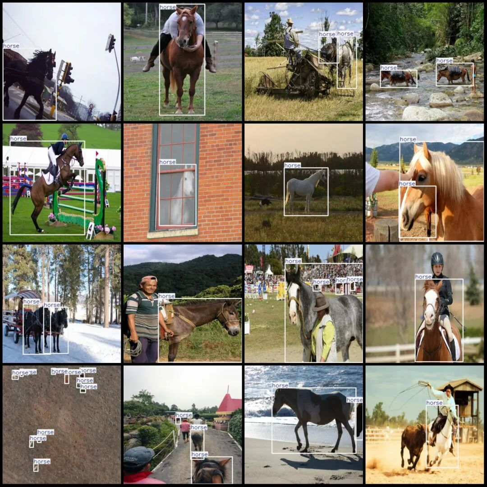

# Horse Behavior State Detection Dataset VOC+YOLO format with 3 categories, 3267 images.

Dataset format: Pascal VOC format + YOLO format (txt file without split path, only containing jpg images and corresponding VOC format xml files and yolo format txt files)

Number of images (number of jpg files): 3267

Number of annotations (number of xml files): 3267

Number of annotations (number of txt files): 3267

Label category count: 3

Label category names (Note that the order of yolo format categories does not correspond to this, but is based on the classes.txt in the labels folder): ["eating", "horse", "sleeping"]

Number of boxes labeled in each category:

The number of "eating" (intake) frames is 1756.

horse (horse) frame count = 7327

Sleeping (in bed) frame count = 142

Total frame count: 9225

Number of images per category:

Eating (in the process of eating) has 598 images.

horse (horse) occupies a picture count = 3013

Sleeping (in the midst of sleep) has 71 images.

Image resolution: 416x416

Using labelImg:

Annotation rules: Draw a rectangle around the category.

Important Notice: The dataset does not have separate training, validation, and test sets; you need to partition them yourself.

Special : This dataset does not guarantee the accuracy of the trained models or weight files.

Image Preview:

Annotation example:

## Payment

Here is a pay link on Stripe ( https://buy.stripe.com/3cs8yP7sY87d0vu9AB ). Please contact me lonlonago@foxmail.com after funding $89, and I will send you a complete data files , thank you!

